# Poly Haven: Concrete textures

**37 assets from [Poly Haven](https://polyhaven.com), dedicated to the public domain under [CC0](https://polyhaven.com/license).** Use them in any game, free or paid, and change them however you like; no credit is needed.

PBR textures as 1K and 2K JPG maps (colour, normal (GL and DX), roughness, AO, displacement and more). 882.6 MB in all.

This is a copy kept by [zuujis-cc0](https://github.com/zuujis-cc0) so game makers can take single files from GitHub. It is not made by or affiliated with Poly Haven: the originals, often in more formats and higher resolutions, are on [polyhaven.com](https://polyhaven.com). If they help you, consider [supporting Poly Haven](https://www.patreon.com/polyhaven/overview).

Every file is listed in [MANIFEST.tsv](MANIFEST.tsv) with its size and SHA-256. More free assets: [the Zuujis collection](https://github.com/zuujis-cc0/free-game-assets#readme).

| | | | |
| :-: | :-: | :-: | :-: |
| <a href="cracked_concrete_02">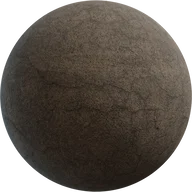</a> <b><a href="cracked_concrete_02">Cracked Concrete 02</a></b> by Charlotte Baglioni · <a href="https://polyhaven.com/a/cracked_concrete_02">source</a> | <a href="cracked_concrete_wall">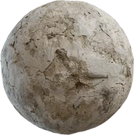</a> <b><a href="cracked_concrete_wall">Cracked Concrete Wall</a></b> by Dimitrios Savva, Rico Cilliers · <a href="https://polyhaven.com/a/cracked_concrete_wall">source</a> | <a href="damaged_concrete_floor">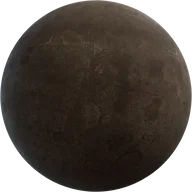</a> <b><a href="damaged_concrete_floor">Damaged Concrete Floor</a></b> by Rob Tuytel · <a href="https://polyhaven.com/a/damaged_concrete_floor">source</a> | <a href="damaged_concrete_floor_02">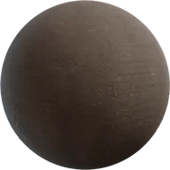</a> <b><a href="damaged_concrete_floor_02">Damaged Concrete Floor 02</a></b> by Rob Tuytel · <a href="https://polyhaven.com/a/damaged_concrete_floor_02">source</a> |
|  <b><a href="damaged_concrete_floor_03">Damaged Concrete Floor 03</a></b> by Amal Kumar · <a href="https://polyhaven.com/a/damaged_concrete_floor_03">source</a> | <a href="damaged_plaster">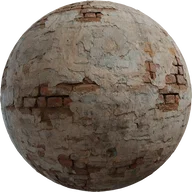</a> <b><a href="damaged_plaster">Damaged Plaster</a></b> by Amal Kumar · <a href="https://polyhaven.com/a/damaged_plaster">source</a> | <a href="dirty_concrete">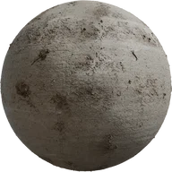</a> <b><a href="dirty_concrete">Dirty Concrete</a></b> by Rob Tuytel · <a href="https://polyhaven.com/a/dirty_concrete">source</a> | <a href="embedded_rock_floor">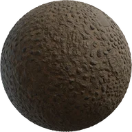</a> <b><a href="embedded_rock_floor">Embedded Rock Floor</a></b> by Dimitrios Savva · <a href="https://polyhaven.com/a/embedded_rock_floor">source</a> |
| <a href="exterior_wall_cladding_03">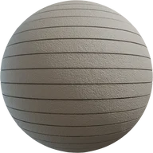</a> <b><a href="exterior_wall_cladding_03">Exterior Wall Cladding 03</a></b> by Charlotte Baglioni · <a href="https://polyhaven.com/a/exterior_wall_cladding_03">source</a> | <a href="garage_floor">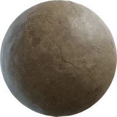</a> <b><a href="garage_floor">Garage Floor</a></b> by Jenelle van Heerden · <a href="https://polyhaven.com/a/garage_floor">source</a> | <a href="granular_concrete">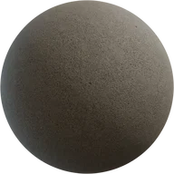</a> <b><a href="granular_concrete">Granular Concrete</a></b> by Dario Barresi, Michael Jenkins · <a href="https://polyhaven.com/a/granular_concrete">source</a> | <a href="gravel_concrete">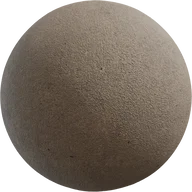</a> <b><a href="gravel_concrete">Gravel Concrete</a></b> by Charlotte Baglioni, Dario Barresi · <a href="https://polyhaven.com/a/gravel_concrete">source</a> |
| <a href="gravel_concrete_02">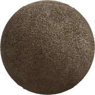</a> <b><a href="gravel_concrete_02">Gravel Concrete 02</a></b> by Charlotte Baglioni, Dario Barresi · <a href="https://polyhaven.com/a/gravel_concrete_02">source</a> | <a href="gravel_concrete_03">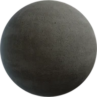</a> <b><a href="gravel_concrete_03">Gravel Concrete 03</a></b> by Charlotte Baglioni · <a href="https://polyhaven.com/a/gravel_concrete_03">source</a> | <a href="gravel_concrete_04">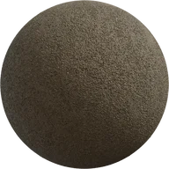</a> <b><a href="gravel_concrete_04">Gravel Concrete 04</a></b> by Dimitrios Savva · <a href="https://polyhaven.com/a/gravel_concrete_04">source</a> | <a href="gravel_embedded_concrete">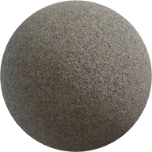</a> <b><a href="gravel_embedded_concrete">Gravel Embedded Concrete</a></b> by Charlotte Baglioni · <a href="https://polyhaven.com/a/gravel_embedded_concrete">source</a> |
| <a href="gravel_embedded_concrete_02">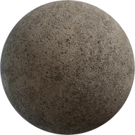</a> <b><a href="gravel_embedded_concrete_02">Gravel Embedded Concrete 02</a></b> by Charlotte Baglioni · <a href="https://polyhaven.com/a/gravel_embedded_concrete_02">source</a> | <a href="grey_plaster">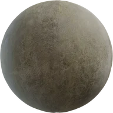</a> <b><a href="grey_plaster">Grey Plaster</a></b> by Rob Tuytel · <a href="https://polyhaven.com/a/grey_plaster">source</a> | <a href="grey_plaster_02">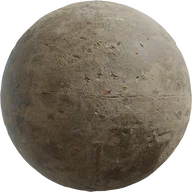</a> <b><a href="grey_plaster_02">Grey Plaster 02</a></b> by Rob Tuytel · <a href="https://polyhaven.com/a/grey_plaster_02">source</a> | <a href="grey_plaster_03">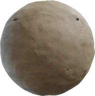</a> <b><a href="grey_plaster_03">Grey Plaster 03</a></b> by Rob Tuytel · <a href="https://polyhaven.com/a/grey_plaster_03">source</a> |
| <a href="grooved_concrete_driveway">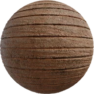</a> <b><a href="grooved_concrete_driveway">Grooved Concrete Driveway</a></b> by Dimitrios Savva · <a href="https://polyhaven.com/a/grooved_concrete_driveway">source</a> | <a href="hacked_concrete">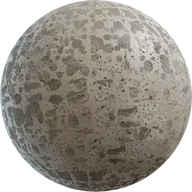</a> <b><a href="hacked_concrete">Hacked Concrete</a></b> by Dimitrios Savva · <a href="https://polyhaven.com/a/hacked_concrete">source</a> | <a href="hangar_concrete_floor">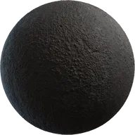</a> <b><a href="hangar_concrete_floor">Hangar Concrete Floor</a></b> by Dimitrios Savva · <a href="https://polyhaven.com/a/hangar_concrete_floor">source</a> | <a href="medieval_wall_01">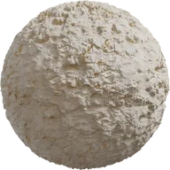</a> <b><a href="medieval_wall_01">Medieval Wall 01</a></b> by Rob Tuytel · <a href="https://polyhaven.com/a/medieval_wall_01">source</a> |
| <a href="painted_concrete">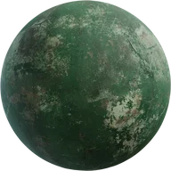</a> <b><a href="painted_concrete">Painted Concrete</a></b> by Dario Barresi, Dimitrios Savva · <a href="https://polyhaven.com/a/painted_concrete">source</a> | <a href="painted_concrete_02">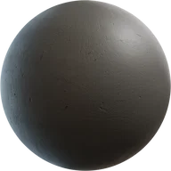</a> <b><a href="painted_concrete_02">Painted Concrete 02</a></b> by Rob Tuytel · <a href="https://polyhaven.com/a/painted_concrete_02">source</a> | <a href="painted_plaster_wall">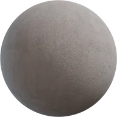</a> <b><a href="painted_plaster_wall">Painted Plaster Wall</a></b> by Amal Kumar · <a href="https://polyhaven.com/a/painted_plaster_wall">source</a> | <a href="patterned_clay_plaster">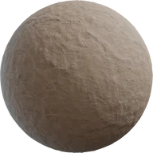</a> <b><a href="patterned_clay_plaster">Patterned Clay Plaster</a></b> by Amal Kumar · <a href="https://polyhaven.com/a/patterned_clay_plaster">source</a> |
| <a href="patterned_clay_wall">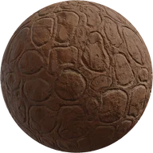</a> <b><a href="patterned_clay_wall">Patterned Clay Wall</a></b> by Dario Barresi, Dimitrios Savva, Rico Cilliers · <a href="https://polyhaven.com/a/patterned_clay_wall">source</a> | <a href="patterned_concrete_pavers_03">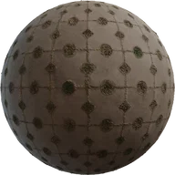</a> <b><a href="patterned_concrete_pavers_03">Patterned Concrete Pavers 03</a></b> by Amal Kumar · <a href="https://polyhaven.com/a/patterned_concrete_pavers_03">source</a> | <a href="patterned_plaster_wall">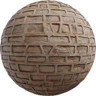</a> <b><a href="patterned_plaster_wall">Patterned Plaster Wall</a></b> by Amal Kumar · <a href="https://polyhaven.com/a/patterned_plaster_wall">source</a> | <a href="pebble_cemented_floor">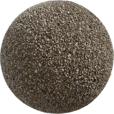</a> <b><a href="pebble_cemented_floor">Pebble Cemented Floor</a></b> by Dario Barresi, Dimitrios Savva · <a href="https://polyhaven.com/a/pebble_cemented_floor">source</a> |
| <a href="pebble_embedded_concrete">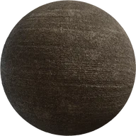</a> <b><a href="pebble_embedded_concrete">Pebble Embedded Concrete</a></b> by Charlotte Baglioni · <a href="https://polyhaven.com/a/pebble_embedded_concrete">source</a> | <a href="pebble_embedded_pavement">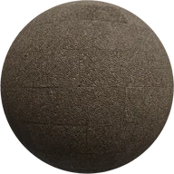</a> <b><a href="pebble_embedded_pavement">Pebble Embedded Pavement</a></b> by Charlotte Baglioni · <a href="https://polyhaven.com/a/pebble_embedded_pavement">source</a> | <a href="peeling_painted_wall">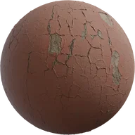</a> <b><a href="peeling_painted_wall">Peeling Painted Wall</a></b> by Dimitrios Savva · <a href="https://polyhaven.com/a/peeling_painted_wall">source</a> | <a href="plaster_brick_01">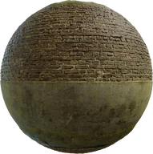</a> <b><a href="plaster_brick_01">Plaster Brick 01</a></b> by Rob Tuytel · <a href="https://polyhaven.com/a/plaster_brick_01">source</a> |
| <a href="plaster_brick_pattern">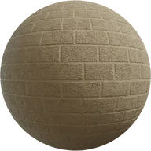</a> <b><a href="plaster_brick_pattern">Plaster Brick Pattern</a></b> by Amal Kumar · <a href="https://polyhaven.com/a/plaster_brick_pattern">source</a> |  |  |  |

---

Kept up to date by this repository's own [update workflow](.github/workflows/update.yml), with code and plan from [cc0-mirror](https://github.com/zuujis-cc0/cc0-mirror). Something wrong? [Open an issue there](https://github.com/zuujis-cc0/cc0-mirror/issues/new) or use the [private report form](https://games.zuujis.com/report).
